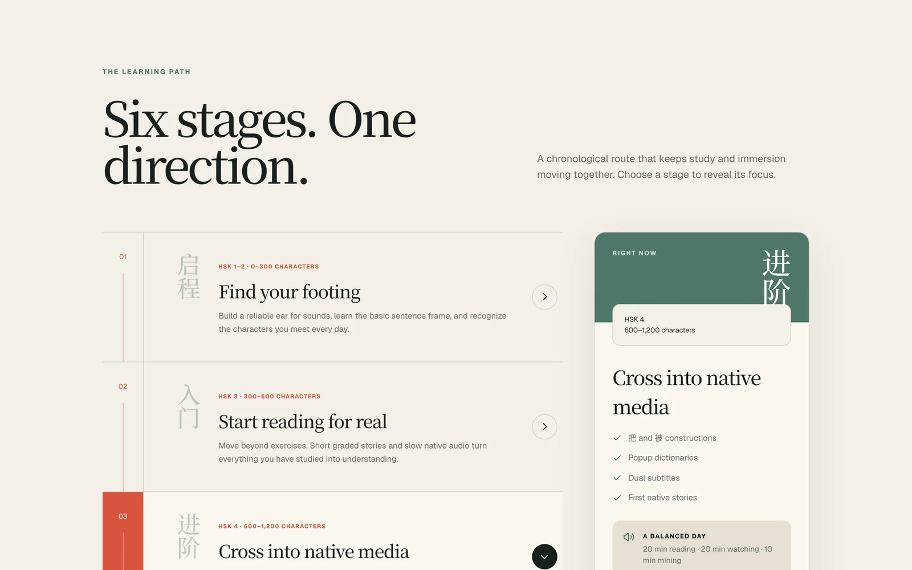
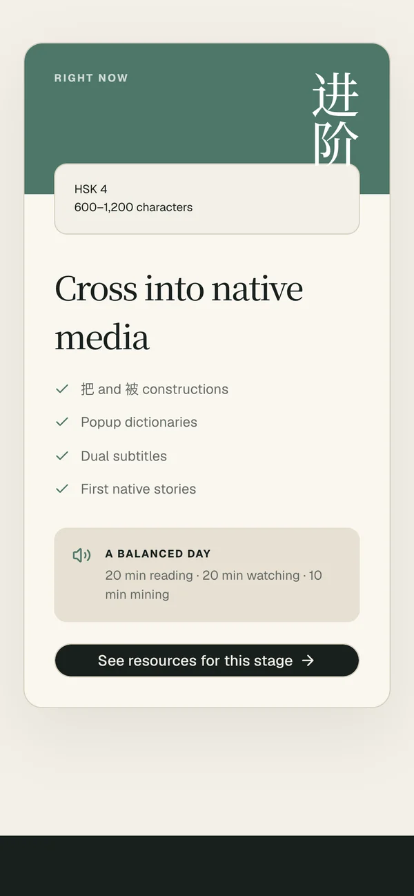

# Mandarin Atlas

A level-by-level map for learning Mandarin Chinese: pick where you are, and see what to study
next and what to read, watch and listen to at that stage.

**Live at [mandarin-atlas-one.vercel.app](https://mandarin-atlas-one.vercel.app)**



## Features

- **Six stages**: from brand new (HSK 1–2, 0–300 characters) to native media ready
  (3,000+ characters). Each stage has a short description, a list of things to focus on and a
  suggested daily routine.
- **Level finder**: pick the description closest to you at the top of the page, and the path
  and the resource shelf switch to that stage.
- **Resource shelf**: 61 hand-picked courses, grammar references, apps, books, culture sites,
  shows and podcasts, each tagged with the stages it suits and marked Free, Freemium or Paid.
- **Filters**: category tabs (Courses, Grammar, Apps, Books, Culture, Watch, Listen) and a
  search box that matches titles, Chinese names and descriptions within the current stage.
- **Method**: a short note on balancing structured study with early immersion.

| Resource shelf | Mobile |
| --- | --- |
|  |  |

## Development

Requires Node 22.13+ and npm (the repo uses `package-lock.json`).

```bash
npm install
npm run dev         # http://localhost:3000
npm run lint        # oxlint
npm run format      # oxfmt
npm run build
```

## How it's built

Next.js 16 (App Router), React 19, TypeScript, Tailwind CSS 4 and shadcn/ui components. The site
is one statically rendered page, deployed on Vercel. All stages and resources are plain data in
the page component, so adding a resource means adding one object to the `resources` array.

| Path | What |
| --- | --- |
| `app/page.tsx` | The page, plus the `stages` and `resources` data and the filtering logic |
| `app/globals.css` | Theme colors and the page's custom styles |
| `app/layout.tsx` | Fonts (Geist, Noto Serif SC) and Open Graph metadata |
| `components/ui/` | shadcn/ui components |

Resource logos come from Google's favicon service, which `next.config.ts` allows as an image host.

## License

Mixed; see [LICENSE.md](LICENSE.md). The application code is under a permissive MIT-style
notice. The sentence records in `lib/sentences.ts` are adapted from the
[AllSet Learning Chinese Grammar Wiki](https://resources.allsetlearning.com/chinese/grammar/) or
original, and are licensed under
[CC BY-NC-SA 3.0](https://creativecommons.org/licenses/by-nc-sa/3.0/).
